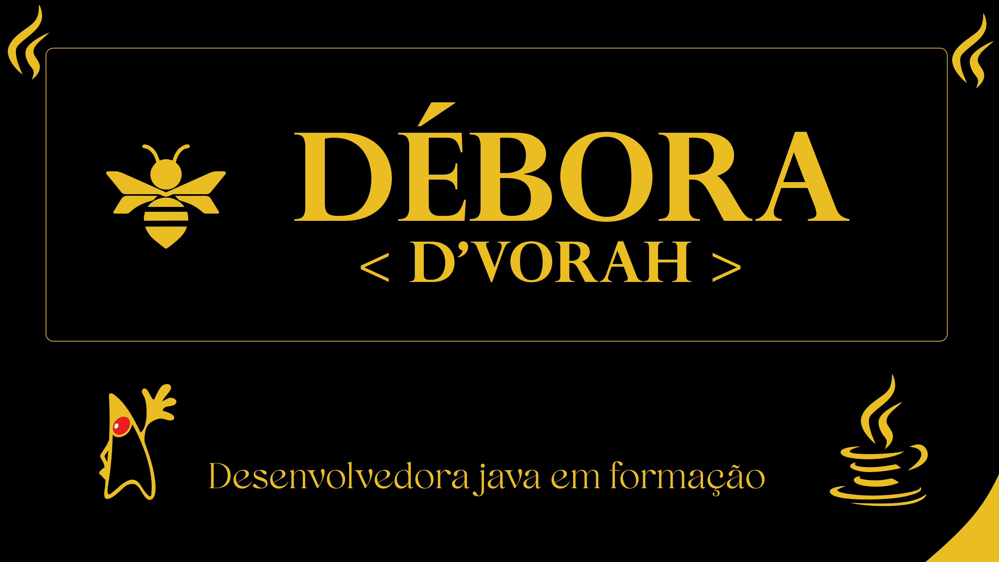

  

---

<h2 style="color: #FFFF00;">💛 Sobre mim</h2>

Olá! Sou estudante de programação e estou desenvolvendo minhas habilidades em Java.

- 🎯 Buscando minha primeira oportunidade como desenvolvedora Java júnior

---

## 🛠️ Tecnologias e ferramentas

---

## 📂 Meus projetos

🚧 **Projetos em construção!**

Em breve, este espaço terá meus projetos desenvolvidos durante os estudos de Java.

---

## 💛 Minhas estatísticas

## 💛 Vamos nos conectar?

### 🖤 Um passo de cada vez, sempre evoluindo! 💛

